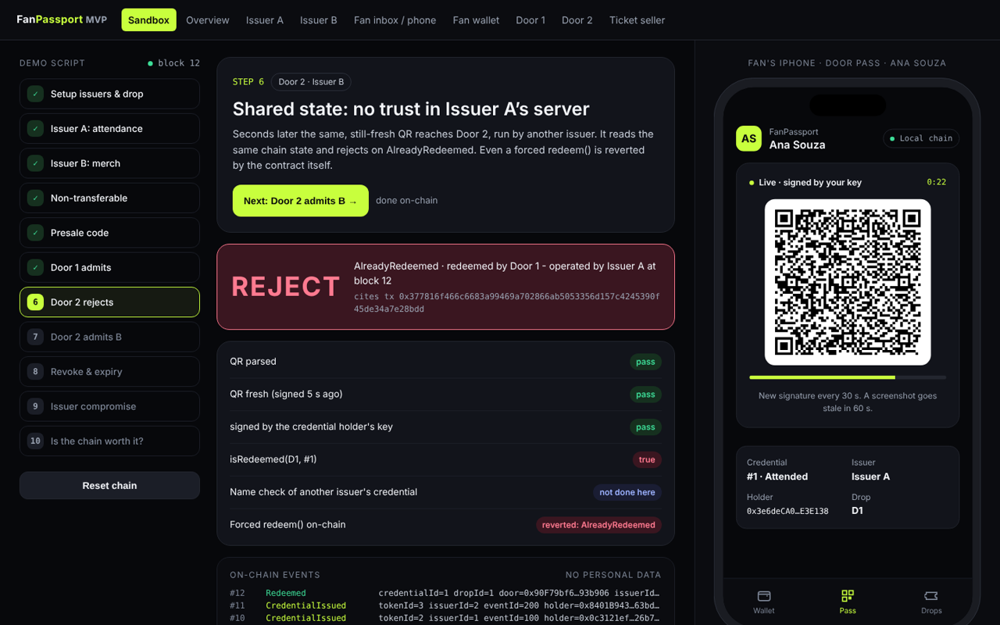
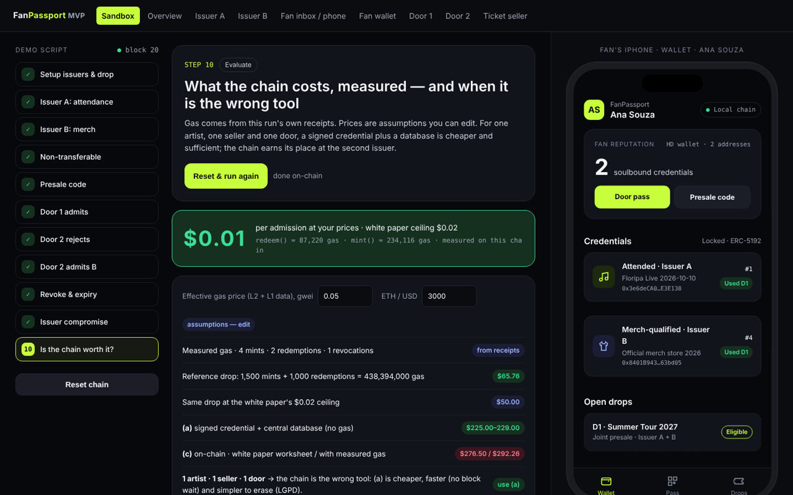
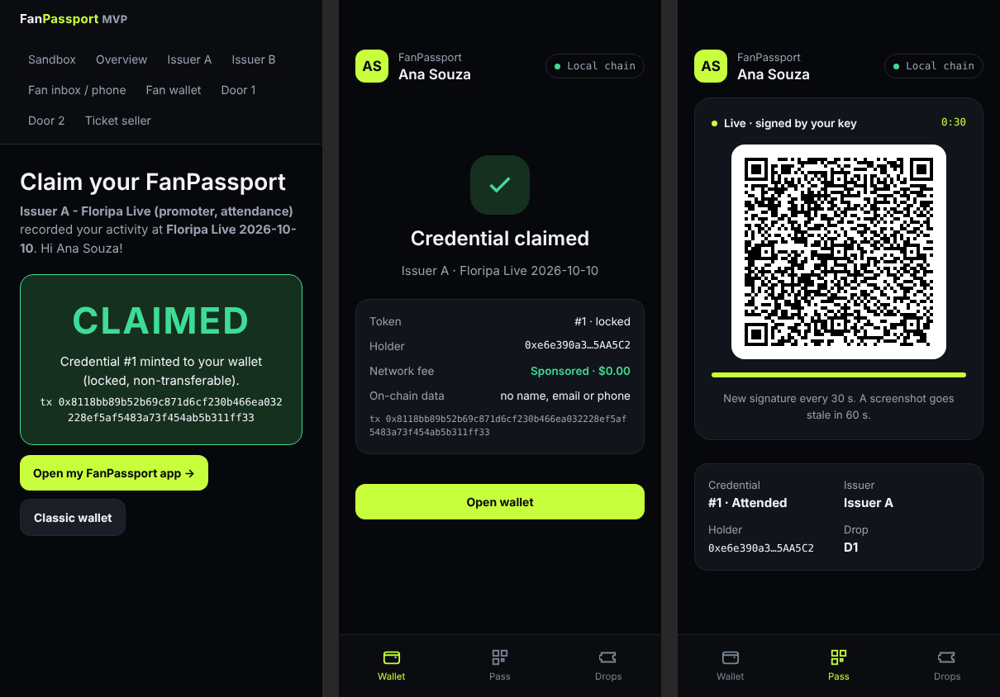
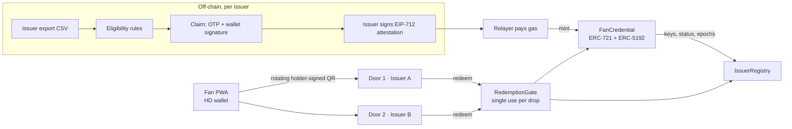

# FanPassport

[](https://github.com/LukasThome/fan-passport/actions/workflows/test.yml)

**Fair access to the shows fans love.** PD3 MVP · Group 5 · INE5458 Blockchain and Cryptocurrencies Technologies · UFSC

FanPassport turns the shows you have really been to into a pass for the next one. An issuer (artist, promoter or label) turns its own attendance and merch records into **non-transferable credentials**. Each fan gets a **single-use presale code** for the ticket seller they already use. At the door, a **rotating QR signed by the fan's key** is checked and the credential is **redeemed on-chain**, so a second door run by a *different* issuer rejects it.



> **Why a chain at all?** For one artist, one seller and one door, a signed credential plus a database is cheaper and sufficient: the MVP shows that number live (step 10). The chain earns its place at the **second issuer**, when independent issuers and doors must share single-use state without appointing a trusted operator. That is exactly the scenario this MVP stages.

| Course objective | Where the MVP shows it |
|---|---|
| **Understand** | Hash commitments instead of personal data on-chain, EIP-712 signatures from issuers and holders, ERC-5192 locked tokens |
| **Build** | Three Solidity contracts, 100% line coverage, a relayer that pays gas, two independent door front-ends |
| **Evaluate** | Gas measured from the run's own receipts, set against the white paper's worksheet, with the case where the chain is the wrong tool |

---

## Run it (local, about 1 minute)

Requires Node.js 18+ (22 recommended). No compiler download: Solidity 0.8.24 comes from the `solc` npm package.

```bash
npm install
npm test        # 157 tests: contracts, off-chain rules, API end to end
npm start       # in-process chain + web app on http://localhost:3000
```

Open **http://localhost:3000**. The **Sandbox** puts the demo script on the left (every step runs for real against the contracts) and the fan's iPhone on the right, which follows along. *Reset chain* redeploys fresh contracts.

**Backup run:** `docs/media/sandbox-demo-run.mp4` (54 s screen recording of the sandbox) and `npm run demo:cli` (the same script in the terminal, with a report).

### The demo, step by step

| # | Step | What happens on-chain | Outcome |
|---|---|---|---|
| 0 | Setup | Admin registers Issuer A (promoter) and Issuer B (artist store), their doors, and joint drop D1 | Permissioned registry |
| 1 | Issuer A: attendance | Check-in CSV → rules → claim (OTP + wallet signature) → relayer mints | 2 credentials, 2 rows rejected, non-listed email refused |
| 2 | Issuer B: merch | Order CSV → rules → Ana claims at a second address | Orders under $15, refunded, unpaid or inside the hold are rejected |
| 3 | Non-transferable | `transferFrom` from the holder | `Soulbound()` revert |
| 4 | Presale code | HMAC code per credential, uploaded to the mock seller | Works once; the seller never sees names |
| 5 | Door 1 admits | Holder-signed QR, chain checks, ID match, `redeem()` | **ADMIT** after a success receipt |
| 6 | Door 2 rejects | Same fresh QR at another issuer's door | **AlreadyRedeemed**, citing Door 1's tx; a forced `redeem()` reverts |
| 7 | Door 2 admits B | Issuer B's own credential | **ADMIT** |
| 8 | Revoke and expiry | Refund revokes A2; re-scan; stale QR | `AlreadyRedeemed`, `Revoked`, `ProofExpired` |
| 9 | Issuer compromise | Suspend → epoch bump → re-attest | Contained; re-issue **cannot** reset single use |
| 10 | Is the chain worth it? | Gas from this run's receipts × editable prices | (a) database vs (c) chain per reference drop |



### With a real phone and the webcam

On the same Wi-Fi, `npm start` prints a LAN address. On a phone, open the **Fan inbox** (or scan the claim QR shown there), claim with the one-time code, and open the door pass. On the laptop, open **Door 1 → Scan with camera** (on `localhost`, so the browser allows the webcam) and point it at the phone.



---

## Public testnet run (Base Sepolia)

The live demo runs locally for reliability. The same script runs on the white paper's public L2 testnet and writes a report with Basescan links:

```bash
npm run testnet:keys    # throwaway keys for the six roles (git-ignored); prints the admin address
#   send ~0.01 Base Sepolia ETH from a faucet to that address
npm run testnet:demo    # funds the other roles, deploys, runs Appendix A, writes docs/testnet-run-baseSepolia.md
```

The run was rehearsed against a separate Hardhat node with six independent role keys (`npm run testnet:rehearsal`). `npm run start:testnet` serves the sandbox against Base Sepolia too; each *Reset chain* deploys again.

---

## Architecture



| Contract | Responsibility |
|---|---|
| `IssuerRegistry` | Permissioned issuer list (admin = team multisig in the white paper, handed over with `transferAdmin`), suspension, epochs for compromise recovery, 24 h timelocked key rotation, door registration |
| `FanCredential` | Locked ERC-721 (ERC-5192). Anyone (the relayer) mints against an EIP-712 attestation signed by an active issuer's key. One credential per identity commitment per event and epoch. Revocation and burning by the issuer or admin |
| `RedemptionGate` | Drops and accepted issuers. `redeem()` checks the door, drop, single-use state, validity, accepted issuer, proof freshness (≤ 60 s) and the holder's signature, then sets the redeemed flag once |

**On-chain:** issuerId, credential type, eventId, identity commitment, status and redemption flags. **Off-chain, held by each issuer:** names, emails, phones, orders, check-in logs, salts and code lists. A test asserts that no personal data appears in any on-chain event.

### A finding from testing

The first sandbox run of the compromise step showed that single use was keyed by **token id**. A credential re-attested after an epoch bump, or re-issued after a lost wallet, came back "unused" and could enter the same drop twice. `RedemptionGate` now keys redemptions by the credential's identity, `keccak(issuerId, eventId, commitment)`, and emits that key, so doors cite the original redemption even for a re-issued token (`test/contracts/reissue.test.js`). This sharpens the white paper's compromise-recovery procedure (section 4.2).

---

## Quality: test-driven from the white paper

The acceptance criteria are the white paper's Appendix A, written as Gherkin in [`docs/demo-script.feature`](docs/demo-script.feature). The commit history shows each feature going red → green.

| Suite | Files | Covers |
|---|---|---|
| Contract acceptance | `test/contracts/demoScript.test.js` | Appendix A steps on the contracts, plus attacks: forged or tampered attestations, wrong holder key, replay across drops, non-door callers, clock skew |
| Lifecycle and guards | `issuerRegistry.test.js`, `guards.test.js`, `reissue.test.js` | Suspension, epochs, timelocked rotation, admin handover, every refused input, re-issuance |
| Off-chain rules | `test/lib/*.test.js` | TOTP against the RFC 4226/6238 vectors, presale codes (HKDF + HMAC, base32), identity commitments, eligibility rules, CSV |
| End to end (API) | `test/api/*.test.js` | Full demo script over HTTP, measured costs, compromise, reset, camera/LAN pages, scripted testnet runner and its report |

Contract coverage (`npm run coverage`): **100% statements, 100% lines, 100% functions, 97.6% branches**. CI runs the tests, coverage and the terminal demo on every push.

## Evaluate: what the chain costs

Measured on this code (Hardhat, optimizer on): `mint` ≈ 234k gas, `redeem` ≈ 87k gas, `revoke` ≈ 39k gas. A reference drop (1,500 mints + 1,000 redemptions) is ≈ 438M gas. The sandbox converts this with editable prices (labelled as assumptions) and sets it beside the white paper's worksheet: (a) signed credential + database, $225–229, vs (c) on-chain, $276.50 at the $0.02-per-transaction ceiling. **One artist, one seller, one door → use (a). Two or more distrusting issuers and doors → only (c) gives single use without a trusted operator.**

## What is mocked (as scoped in the white paper)

All fan data is synthetic (`data/*.csv`). E-mail and SMS/OTP delivery are a mock inbox. The ticket seller is a mock page that accepts uploaded code lists. ID checks are a staff checkbox. There are no payments. Joint-drop consent is mocked by a single drop creator (the admin). All off-chain actors run in one Node process, each with its own key, and each door still decides only from the signed QR and the shared chain state.

## Known limits (honest list)

- A presale code can still be passed on. We raise the cost of scalping (locked credential, rotating QR, name-matched door check) rather than eliminate it.
- The chain records the issuer's claim; it does not make the activity true. A colluding issuer can mint sybil credentials, which the registry, the public issuance log and revocation mitigate.
- The admin is a standing trust assumption until it is handed over to an issuers' multisig.
- The fan's key lives in the browser (`localStorage`), so losing it means re-issuance, which can no longer reset single use.
- Offline doors (a bounded double-entry window) and ZK privacy are roadmap, not MVP.

## Repository map

```
contracts/          IssuerRegistry, FanCredential (ERC-5192), RedemptionGate
lib/                eligibility rules, identity commitments, presale codes, TOTP, EIP-712 types, CSV
src/                system (deploy + Step 0), app (HTTP API), server (resettable), demoRunner
public/             sandbox (index), phone app, issuer portal, inbox, claim, wallet, doors, seller
scripts/            start, demo-cli, deploy, testnet-keys, testnet-demo
test/               contracts, lib, api
docs/               demo-script.feature, media (screenshots, backup video), testnet run reports
```

## Team

- Arthur Bastos: Programming and Software Engineering, backend + frontend
- Felix Gebhardt: Engineering and Strategy
- Lucas Thomé da Silva: Quality Assurance Engineering, software testing

The TOTP code is ported from our INE5680 project [security-mini-blockchain](https://github.com/LukasThome/security-mini-blockchain). License: MIT.
